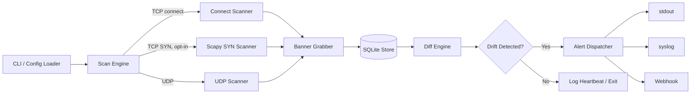

# DriftSentry — Port Scanner with Drift Detection
*Product Requirements Document*

| | |
|---|---|
| **Status** | Draft v0.1 |
| **Category** | Network & Recon / Attack Surface Monitoring |
| **Target Platform** | Kali Linux (primary), Debian/Ubuntu-compatible |
| **Interface** | Command-line tool |
| **Last Updated** | 2026-09-13 |

> "DriftSentry" is a placeholder project name — swap in whatever you like.

---

## 1. Executive Summary

DriftSentry is a CLI tool that scans TCP/UDP ports on a target host or CIDR range, persists every scan result locally, and — unlike a one-shot scanner — automatically **diffs each run against the prior one**. Instead of answering "what's open right now," it answers "what changed, and when," turning a static snapshot into a timeline of attack-surface drift: new ports, vanished ports, and changed service banners. It's meant to run unattended (cron/systemd timer, or its own loop) and alert only when something actually changes.

## 2. Problem Statement

Point-in-time scanners (Nmap, Masscan, RustScan) are excellent at telling you what's open *today*, but most real incidents involve a *change*: a dev spins up a debug service and forgets to close it, a firewall rule gets loosened during a deploy, an old box gets re-provisioned and exposes a service nobody expects. Catching that requires either a human manually diffing scan logs (slow, error-prone, rarely done consistently) or a purpose-built tool that treats history as a first-class citizen. DriftSentry is that tool: scanning is the easy 20%, the persistent state + diff engine is the actual product.

## 3. Goals

- Ship a single CLI script/binary that scans a target and stores results in a local, portable datastore.
- Automatically compute a diff against the previous scan (or an arbitrary historical scan) and classify what changed.
- Alert on drift through pluggable sinks (stdout, syslog, webhook), not just print a wall of text.
- Run natively and comfortably on Kali Linux, driven by cron, systemd timers, or an internal daemon loop.
- Keep the default (unprivileged) path dependency-light and root-free; treat raw-socket/SYN scanning as an explicit opt-in.

## 4. Non-Goals (v1)

- Vulnerability scanning, CVE correlation, or exploitation — this is an asset/attack-surface monitor, not a vuln scanner.
- Distributed/multi-node scan orchestration — v1 is single-host.
- A web dashboard — CLI + JSON export only (a dashboard is a plausible future phase, see §15).
- IPv6 — architecture shouldn't preclude it, but it's out of MVP scope.
- Active OS fingerprinting.

## 5. Target Users & Use Cases

- **Internal blue teams** monitoring their own IP ranges for shadow IT and unexpected exposure.
- **Small security consultancies** running continuous, contractually-authorized monitoring for clients.
- **DevOps/platform teams** wiring a scan-diff into CI/CD as a post-deploy check ("did we just expose something new?").
- **Home-lab / personal infra owners** wanting an alert when an unexpected port opens on their own network.

Representative scenarios:
1. Nightly cron scan of a company's public IP block; a Slack webhook fires only when a new port appears.
2. Pre-deploy vs. post-deploy scan diff of a staging host, run as a CI step.
3. A continuous 5-minute-interval loop across an internal /22 for shadow-IT discovery.

## 6. Responsible Use

DriftSentry performs active reconnaissance (connection attempts, banner grabs, and optionally raw SYN/UDP packets). It must only be pointed at hosts and ranges the operator owns or has explicit written authorization to test — scanning networks without authorization can violate laws like the U.S. CFAA, UK Computer Misuse Act, or local equivalents. This isn't just a legal footnote — it's a product requirement:

- The first run against a new target range requires an explicit `--authorized` flag or interactive confirmation; the tool refuses to scan otherwise.
- Every scan run logs the operator, target spec, and timestamp to support after-the-fact accountability.
- Default concurrency/rate-limit settings favor being a "good neighbor" on the network over raw speed.

## 7. Functional Requirements

### 7.1 Scanning Engine
- **Targets:** single IP, hostname (DNS-resolved), CIDR block (e.g. `10.0.0.0/24`), or a file of targets, one per line.
- **Ports:** single port, comma list, ranges (`1-1024`), named sets (`top100`/`top1000`, derived from Nmap's frequency-ranked `nmap-services` data), or `all` (1–65535).
- **Protocols:**
  - *TCP connect* (default) — no elevated privileges needed, works everywhere.
  - *TCP SYN* (opt-in) — raw socket, needs `CAP_NET_RAW`; faster and quieter, uses Scapy.
  - *UDP* (best-effort) — send a protocol-appropriate probe, classify as open / closed / `open|filtered` based on response vs. ICMP port-unreachable vs. timeout (UDP scanning is inherently ambiguous; the tool should say so in its output, not pretend otherwise).
- **Banner grabbing:** after a successful TCP connect, attempt a short protocol-aware read (HTTP HEAD, or a raw read-with-timeout for SSH/FTP/SMTP/etc.) to capture a service/version string.
- **Concurrency:** configurable in-flight probe limit and per-probe timeout, plus a rate limiter (probes/sec) so scans don't hammer the target or trip an unrelated IDS/IPS.

### 7.2 Persistent Store
- **SQLite** as the default backend — zero external services, ships in Python's stdlib.
- **JSON export** as a secondary/interchange format (for piping into other tooling).
- Schema covers hosts, scans (one row per run), per-port results, and derived drift events (full DDL in §10).
- **Retention:** configurable by scan count or by age, plus a `prune` command that also runs `VACUUM`.

### 7.3 Diff Engine
- Compares the latest scan against either the immediately prior scan or an explicitly chosen baseline/historical scan (`--compare-to <scan_id>`).
- Detects: newly open port, closed port, banner/service-version change, host newly reachable, host gone unreachable.
- Emits a structured JSON diff plus a human-readable summary.
- Optional debounce: only alert once a change is confirmed across **N consecutive scans**, to filter out one-off network blips.

### 7.4 Alerting
- **Sinks:** stdout (default, human-readable, `--json` for machine-readable), syslog, and a generic webhook (POSTs JSON — works as-is with Slack/Discord incoming webhooks or a SIEM ingestion endpoint).
- Fires only on drift by default; `--always-notify` sends a full status report every run (useful as a liveness heartbeat).
- Each event carries a severity (`info` / `warning` / `critical`), configurable per event type.

### 7.5 Scheduling
- **External-scheduler mode (recommended default):** `driftsentry scan -c config.yaml` runs once and exits — driven by cron or a systemd timer. Simpler and more robust than babysitting a long-running process.
- **Daemon/loop mode:** `driftsentry watch -c config.yaml -i 300` sleeps and re-scans internally — handy for interactive use or containers without cron/systemd.

### 7.6 Configuration
- YAML config file for targets, ports, protocol, concurrency/rate limits, retention, and alert sinks.
- CLI flags override config-file values.
- Subcommands: `init`, `scan`, `watch`, `diff`, `history`, `prune`.

### 7.7 Logging & Observability
- Structured, leveled logging (DEBUG/INFO/WARNING/ERROR).
- Per-run summary: targets scanned, ports checked, duration, drift-event count.

## 8. Non-Functional Requirements

- **Performance:** sane defaults should let a /24 × top-1000-ports scan finish in a few minutes on typical hardware; concurrency/timeout are tunable to trade speed for network politeness.
- **Portability:** Kali Linux is the primary target; should run unmodified on any current Debian/Ubuntu.
- **Reliability:** SIGINT/SIGTERM mid-scan must not corrupt the store — wrap writes in transactions, commit incrementally.
- **Least privilege:** raw-socket features should be grantable via Linux capabilities rather than requiring the whole tool to run as root.
- **Extensibility:** alert sinks and scanners should sit behind small interfaces so new ones can be added without touching the diff engine.

## 9. System Architecture



## 10. Data Model (SQLite DDL)

```sql
CREATE TABLE scans (
    scan_id       INTEGER PRIMARY KEY AUTOINCREMENT,
    started_at    TEXT NOT NULL,        -- ISO8601 UTC
    finished_at   TEXT,
    target_spec   TEXT NOT NULL,
    port_spec     TEXT NOT NULL,
    protocol      TEXT NOT NULL,        -- tcp_connect | tcp_syn | udp | mixed
    config_hash   TEXT
);

CREATE TABLE hosts (
    host_id       INTEGER PRIMARY KEY AUTOINCREMENT,
    ip_address    TEXT NOT NULL UNIQUE,
    hostname      TEXT
);

CREATE TABLE results (
    result_id         INTEGER PRIMARY KEY AUTOINCREMENT,
    scan_id           INTEGER NOT NULL REFERENCES scans(scan_id),
    host_id           INTEGER NOT NULL REFERENCES hosts(host_id),
    port              INTEGER NOT NULL,
    protocol          TEXT NOT NULL,    -- tcp | udp
    state             TEXT NOT NULL,    -- open | closed | filtered | open|filtered
    banner            TEXT,
    service_guess     TEXT,
    response_time_ms  INTEGER,
    UNIQUE(scan_id, host_id, port, protocol)
);

CREATE TABLE drift_events (
    event_id       INTEGER PRIMARY KEY AUTOINCREMENT,
    scan_id        INTEGER NOT NULL REFERENCES scans(scan_id),
    prior_scan_id  INTEGER REFERENCES scans(scan_id),
    host_id        INTEGER NOT NULL REFERENCES hosts(host_id),
    port           INTEGER,
    event_type     TEXT NOT NULL,       -- new_port | closed_port | banner_change | host_up | host_down
    detail         TEXT,                -- JSON blob with before/after
    detected_at    TEXT NOT NULL,
    severity       TEXT NOT NULL        -- info | warning | critical
);

CREATE INDEX idx_results_scan ON results(scan_id);
CREATE INDEX idx_drift_scan   ON drift_events(scan_id);
```

## 11. CLI Specification

```text
driftsentry init                            # create config + local db
driftsentry scan   -c config.yaml           # run one scan, store, diff, alert
driftsentry watch  -c config.yaml -i 300    # loop mode, scan every 300s
driftsentry diff   --from <id> --to <id>    # ad hoc diff between two stored scans
driftsentry history --host 10.0.0.5         # scan history for one host
driftsentry prune  --keep-days 90           # retention cleanup + VACUUM
```

Common flags for `scan` / `watch`:

```text
-t, --target          CIDR / IP / hostname / file-of-targets
-p, --ports           port spec, e.g. "1-1000,8080" or "top100"
    --protocol         tcp-connect | tcp-syn | udp | tcp+udp
    --concurrency      max in-flight probes      (default 300)
    --timeout          per-probe timeout, ms      (default 800)
    --rate-limit       max probes/sec             (default: unlimited — set this for politeness)
    --webhook          webhook URL for alerts
    --syslog           enable syslog sink
    --json             machine-readable stdout
    --baseline         compare against a tagged baseline instead of "last scan"
    --authorized       required confirmation for a target seen for the first time
```

## 12. Tech Stack

### 12.1 Primary: Python

| Component | Choice |
|---|---|
| Runtime | Python 3.11+ |
| CLI | `argparse` with subcommands |
| Concurrency | `asyncio` (`asyncio.open_connection`) for TCP-connect scanning — no root needed |
| Raw sockets | `scapy` (ships on Kali) for opt-in SYN/UDP crafting — needs `CAP_NET_RAW` |
| Storage | `sqlite3` (stdlib) |
| Config | `PyYAML` |
| Webhooks | `requests` |
| Output formatting | `rich` (optional, nicer tables/diffs) |

Everything above is either stdlib or already an APT package on Kali (`python3-scapy`, `python3-yaml`, `python3-requests`), so an MVP needs no internet-dependent `pip install` if you'd rather stay fully APT-managed.

### 12.2 Alternative: Go (for scale)

| Component | Choice |
|---|---|
| Runtime | Go 1.22+ |
| Concurrency | goroutines + worker-pool over stdlib `net` |
| Raw sockets | `github.com/google/gopacket` + `gopacket/pcap` (needs `libpcap-dev`, present on Kali) |
| Storage | `database/sql` + `modernc.org/sqlite` (pure Go, no cgo — simplest cross-compiling) or `mattn/go-sqlite3` |
| Config | `gopkg.in/yaml.v3` |

Go's advantage is a single static binary with lower per-connection overhead — worth it once you're scanning multiple /16s rather than a handful of /24s.

### 12.3 Which to pick
Start in Python: faster to build and extend, and Kali already has everything it needs pre-installed. Move to Go only if scan scope grows past what Python's concurrency comfortably handles, or if you want a dependency-free binary to drop onto a minimal box or container.

## 13. Kali Linux–Specific Notes

- Kali ships Python 3 and Scapy out of the box, so the unprivileged (TCP-connect) MVP runs with zero extra installs.
- Raw SYN/UDP crafting needs `CAP_NET_RAW`/`CAP_NET_ADMIN`. Rather than running the whole tool as root, grant the capability to the interpreter (or, better, a small compiled helper that only does the raw send/recv and drops privileges immediately after):
  ```bash
  sudo setcap cap_net_raw,cap_net_admin+eip $(readlink -f $(which python3))
  ```
  Granting it to the whole `python3` binary is broad — for anything beyond a personal box, prefer a dedicated helper binary or just `sudo` the specific SYN-scan subcommand explicitly.
- **Default to TCP-connect** so the tool works out of the box without sudo; SYN/UDP raw modes stay opt-in and clearly documented as privileged.
- Prefer **systemd timers** over cron where possible — Kali is Debian-based with systemd as PID 1, and a `.timer` unit gets you `journalctl` logging, easy enable/disable, and clearer failure visibility. Both are shown in §16 since cron is still the fastest path for a quick setup.
- Respect whatever `iptables`/`ufw` rules are already configured on the box for outbound webhook calls.

## 14. Testing Strategy

- **Unit tests** for the diff engine as a pure function (two result sets in, drift events out) — fast, deterministic, no network.
- **Integration tests** against local ephemeral listeners (`python -m http.server`, `nc -l`, or throwaway Docker containers) with known port states, verifying open/closed/filtered classification.
- **Golden-file tests** for CLI and JSON output formatting.
- **Load test:** a full 1–65535 scan against a local /28 to confirm concurrency/timeout handling doesn't hang or leak file descriptors.

## 15. Milestones

**MVP — v0.1**
- TCP-connect scan (single host or CIDR, port list/range)
- SQLite storage + diff vs. previous scan
- stdout alerting
- Single-run CLI, cron-friendly

**v0.2**
- UDP scan support
- Webhook + syslog sinks
- YAML config file
- `watch` daemon-loop mode
- `prune` / retention command

**v0.3**
- Opt-in SYN scan via Scapy
- Refined banner grabbing / service fingerprinting
- `--baseline` tagging and arbitrary-scan comparison
- `driftsentry install-service` systemd-unit generator

**Stretch**
- IPv6 support
- Read-only local web dashboard rendering the SQLite history as a timeline
- Plugin hooks for lightweight version-detection scripts

## 16. Deployment Examples

**systemd** (`/etc/systemd/system/driftsentry.service` + `.timer`):
```ini
[Unit]
Description=DriftSentry one-shot scan

[Service]
Type=oneshot
ExecStart=/usr/local/bin/driftsentry scan -c /etc/driftsentry/config.yaml
```
```ini
[Unit]
Description=Run DriftSentry every 15 minutes

[Timer]
OnBootSec=2min
OnUnitActiveSec=15min

[Install]
WantedBy=timers.target
```

**cron:**
```text
*/15 * * * * /usr/local/bin/driftsentry scan -c /etc/driftsentry/config.yaml >> /var/log/driftsentry.log 2>&1
```

**Example `config.yaml`:**
```yaml
target: 10.0.0.0/24
ports: top1000
protocol: tcp-connect
concurrency: 300
timeout_ms: 800
rate_limit_pps: 200
retention_days: 90
alerts:
  webhook: https://hooks.example.com/driftsentry
  syslog: true
  json_stdout: false
```

**Example webhook payload:**
```json
{
  "tool": "driftsentry",
  "scan_id": 42,
  "prior_scan_id": 41,
  "timestamp": "2026-09-13T08:15:00Z",
  "host": "10.0.0.5",
  "event_type": "new_port",
  "port": 8080,
  "protocol": "tcp",
  "service_guess": "http",
  "banner": "nginx/1.25.3",
  "severity": "warning"
}
```

## 17. Risks & Mitigations

| Risk | Mitigation |
|---|---|
| Scans get flagged by the target's own IDS/IPS or SOC | Rate limiting by default; document the authorization requirement; recommend a heads-up to the target's security team before scheduled scans |
| Transient network blips misread as drift | Debounce option — require agreement across N consecutive scans before alerting |
| SQLite file grows unbounded over long retention | `prune` command with `VACUUM`; document expected DB size per scan cadence |
| Raw-socket privilege requirements complicate setup | Unprivileged TCP-connect is the default; `setcap`/helper-binary path documented for opt-in SYN mode |
| Webhook URLs/secrets sitting in plaintext config | Recommend `chmod 600` on the config file; support reading the secret from an environment variable instead |

## 18. Success Metrics

- **Detection latency:** a newly opened port should surface within one scan interval of appearing.
- **Alert signal-to-noise:** target under 5% of drift alerts being debounce-filtered "noise" after tuning.
- **Scan throughput:** document actual /24 × top-1000 completion time on reference hardware once the MVP lands, as the benchmark for future tuning.

---

*This PRD defines requirements and architecture; it intentionally stops short of implementation. The natural next step is standing up the `scan` subcommand against the schema in §10.*
